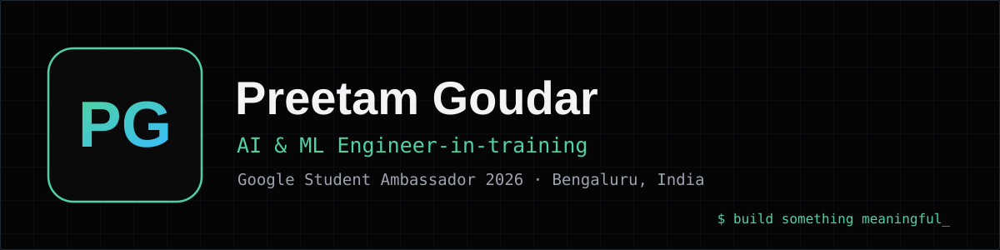

<div align="center">



[](https://preetamggoudar.github.io/)
[](https://www.linkedin.com/in/preetam-goudar-181174324/)
[](https://www.google.com/maps/place/Bengaluru,+Karnataka)

</div>

<br>

<div align="center">

```
$ whoami
Preetam Goudar — AI & ML engineer-in-training
$ cat focus.txt
Generative AI · Computer Vision · Web AI · Open source
$ status
Available for opportunities · Bengaluru, India
```

</div>

## 🧠 About me

I'm a Computer Science student specialising in **Artificial Intelligence and Machine Learning** at **Shri Siddhartha Institute of Technology**, in collaboration with **upGrad School of Technology** (Batch 2026–2030).

I like turning model experiments into things people can actually use — from vision-based extraction systems to AI web apps. I learn fastest by shipping, and I care just as much about the community around the technology as the technology itself. Currently a **Google Student Ambassador 2026**, helping students explore Gemini and Google's AI ecosystem through peer-learning sessions and hands-on events.

## 🚀 Featured work

| Project | What it is | Built with |
| --- | --- | --- |
| [Live Portfolio](https://preetamggoudar.github.io/) | A dark, console-style portfolio with projects, experience, and an interactive shell you can actually type into. | HTML · CSS · JavaScript |
| [CampusClaim](https://github.com/sank8-2/campusclaim) | Receipt-to-reimbursement assistant. Fine-tuned a Gemma 4 vision model to extract receipt fields, with a Gradio review UI and RAG policy retrieval. | Gemma 4 · Gradio · RAG |
| [Open source & experiments](https://github.com/preetamggoudar) | Small builds, Hacktoberfest contributions and notes from learning in public. | Git · Python · Web |

## 🛠️ Tech stack

<div align="center">

[](https://www.python.org/)
[](https://developer.mozilla.org/en-US/docs/Web/JavaScript)
[](https://developer.mozilla.org/en-US/docs/Web/HTML)
[](https://developer.mozilla.org/en-US/docs/Web/CSS)
[](https://git-scm.com/)
[](https://github.com/preetamggoudar)
[](https://www.gradio.app/)
[](https://huggingface.co/)
[](https://en.wikipedia.org/wiki/SQL)
[](https://en.wikipedia.org/wiki/Retrieval-augmented_generation)
[](https://gemini.google.com/)
[](https://claude.ai/)

</div>

**Models I work with:** Claude · Gemini · ChatGPT / GPT · Gemma · Llama · Mistral · DeepSeek · Qwen

## 🏆 Highlights

- **Google Student Ambassador 2026** — selected for the nationwide cohort (GID 16723); championing Google's AI ecosystem on campus.
- **1st Place, Hack Day 2026** — Hacktoberfest Hack Day (MLH × DEV × DigitalOcean), with Team SnakeByte. Prize: ₹7,000.
- **Smart India Hackathon 2026** — built solutions with a team around real-world problems.
- **Learning in public** — open source, hackathons and peer-learning sessions.

## 📊 GitHub stats

<div align="center">


</div>

## 📫 Connect

- **Portfolio:** [preetamggoudar.github.io](https://preetamggoudar.github.io/)
- **LinkedIn:** [preetam-goudar-181174324](https://www.linkedin.com/in/preetam-goudar-181174324/)
- **Email:** [preetamggoudar@gmail.com](mailto:preetamggoudar@gmail.com)

Open to collaborations, hackathons and conversations about AI, product or community.

---

<div align="center">

<sub>Built with care · Deployed on GitHub Pages · © 2026 Preetam Goudar</sub>

</div>
